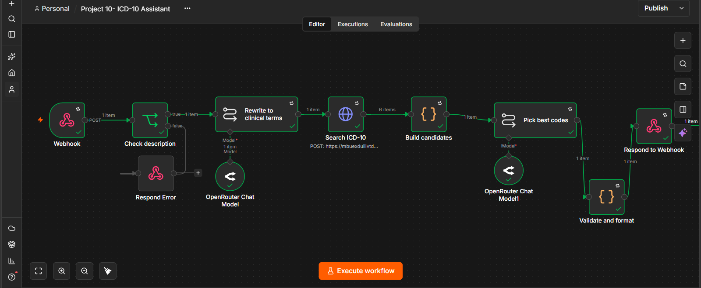
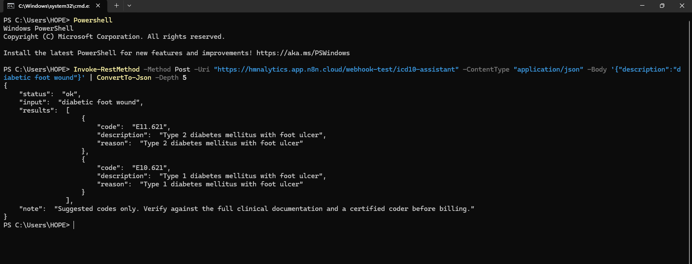
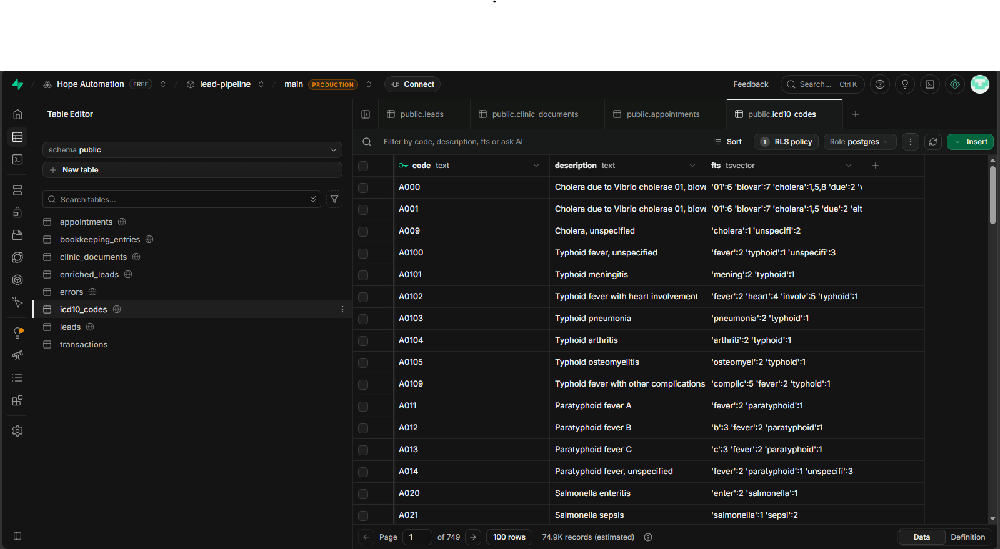
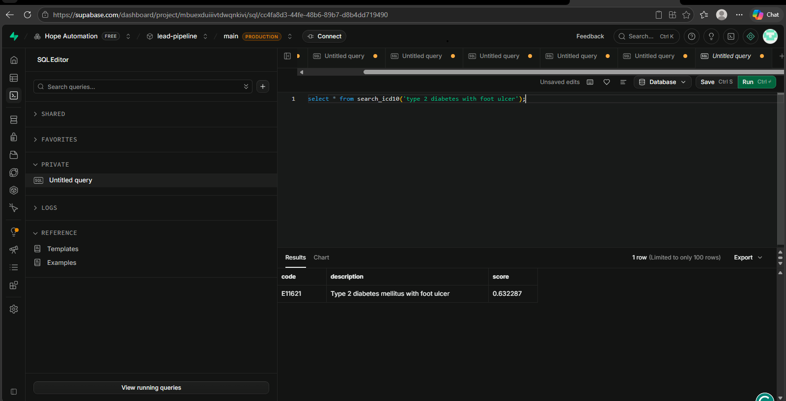
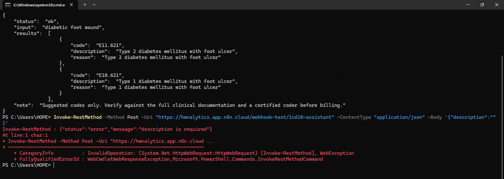

# ICD-10 Assistant (n8n + Supabase + AI)

An AI-assisted ICD-10-CM code lookup built as an n8n workflow. Send a plain-language or clinical description to a webhook and get back suggested diagnosis codes, each with the official description and a short reason. Every code is checked against a real code table, so the AI cannot return a code that does not exist.

> **Disclaimer:** Suggested codes only. This is a portfolio project, not a certified coding tool. Always verify against the full clinical documentation and a certified coder before billing.



## What it does

**Request**

```json
{ "description": "diabetic foot wound" }
```

**Response**

```json
{
  "status": "ok",
  "input": "diabetic foot wound",
  "results": [
    {
      "code": "E11.621",
      "description": "Type 2 diabetes mellitus with foot ulcer",
      "reason": "Type 2 diabetes mellitus with foot ulcer"
    },
    {
      "code": "E10.621",
      "description": "Type 1 diabetes mellitus with foot ulcer",
      "reason": "Type 1 diabetes mellitus with foot ulcer"
    }
  ],
  "note": "Suggested codes only. Verify against the full clinical documentation and a certified coder before billing."
}
```

The description does not say which type of diabetes, so both Type 1 and Type 2 codes are returned. If the description says "type 2", the search narrows to the Type 2 code only (see the screenshots below).

**Empty input** is rejected with a clear error:

```json
{ "status": "error", "message": "description is required" }
```

## How it works

```
Webhook (POST)
   -> Check description (reject empty input with a 400 error)
   -> Rewrite to clinical terms (LLM turns everyday wording into official ICD-10-CM wording)
   -> Search ICD-10 (HTTP Request -> Supabase function search_icd10)
   -> Build candidates (combine matching codes into one list)
   -> Pick best codes (LLM chooses up to 3 from the candidate list only)
   -> Validate and format (drop any code not in the database, add the dot, attach official description)
   -> Respond to Webhook (JSON)
```

### Design decisions

- **No made-up codes.** The AI may only choose from codes returned by the database search, and a final validation step removes anything that is not in the table.
- **Rewrite before search.** Keyword search cannot connect "wound" to the official term "ulcer", so an AI step rewrites the input into clinical wording first.
- **Strict search first, loose search as fallback.** The Postgres function matches all words first and only falls back to matching any word when nothing matches. This avoids results like Type 1 diabetes codes appearing for a Type 2 query.
- **Input validation.** Empty descriptions are rejected with a clear error response.

## Screenshots

### Test response
A POST request from PowerShell to the webhook, returning validated codes.



### ICD-10 code table in Supabase
The `icd10_codes` table holds about 74.9K codes, with a generated `tsvector` column (`fts`) for full-text search.



### Search function
The `search_icd10` function returns a ranked, precise match for a specific query.



### Input validation
An empty description is rejected before any AI call is made.



## Tech stack

- **n8n** (cloud) for orchestration and the webhook API
- **Supabase (Postgres)** for the code table, with full-text search (`tsvector` + GIN index) exposed as an RPC function
- **OpenRouter** chat models for the rewrite and code-selection steps
- **Python** to convert the CMS code file into a CSV for import
- **Data:** FY 2027 ICD-10-CM code descriptions from CMS (74,879 billable codes)

## Repository structure

```
.
├── README.md
├── .gitignore
├── sql/setup.sql                  # table, index, search function and permissions
├── scripts/convert.py             # converts the CMS .txt file to icd10_codes.csv
├── workflow/                      # exported n8n workflow JSON
└── docs/screenshots/              # images used in this README
```

## Setup

1. **Get the data.** Download "2027 Code Descriptions in Tabular Order" from the CMS ICD-10 page (cms.gov/medicare/coding-billing/ICD-10-codes) and extract it.
2. **Convert it.** Place `convert.py` next to `icd10cm_codes_2027.txt` and run `python convert.py`. This produces `icd10_codes.csv`.
3. **Create the database objects.** Run `sql/setup.sql` in the Supabase SQL Editor. The script is safe to re-run.
4. **Import the CSV.** In Supabase, open Table Editor, choose `icd10_codes`, then Insert > Import data from CSV. Map `code` and `description` and leave `fts` unmapped.
5. **Import the workflow.** In n8n, import the JSON from `workflow/`.
6. **Add credentials.** Create a Supabase API credential and an OpenRouter credential in n8n (credentials are not included in the export). Update the **Search ICD-10** node URL to `https://<your-project-ref>.supabase.co/rest/v1/rpc/search_icd10`.
7. **Test.** Publish the workflow and send a POST request to the production webhook URL:

```powershell
Invoke-RestMethod -Method Post -Uri "https://<your-n8n-host>/webhook/icd10-assistant" -ContentType "application/json" -Body '{"description":"acute appendicitis with perforation"}' | ConvertTo-Json -Depth 5
```

Verify the data loaded with:

```sql
select count(*) from icd10_codes;
select * from search_icd10('type 2 diabetes with foot ulcer');
```

## Security notes

- The CMS file and the generated CSV are large public data and are excluded by `.gitignore`.
- No API keys are stored in this repo. Credentials live in n8n and Supabase.
- The webhook is a public endpoint. Consider adding authentication before sharing the URL widely.

## Limitations

- Covers ICD-10-CM (US) only, not WHO ICD-10 or ICD-11.
- Retrieval is keyword-based, so unusual phrasing depends on the AI rewrite step.
- It suggests codes from a short description and cannot apply full coding guidelines (laterality, encounter type, sequencing).

## Roadmap

- Add embeddings (pgvector) as a second retrieval method for meaning-based matching
- Support WHO ICD-10 and ICD-11
- Return a "needs more detail" response when the description is too vague to code
- Add a simple chat front end

## Author

Hope Mutheu
